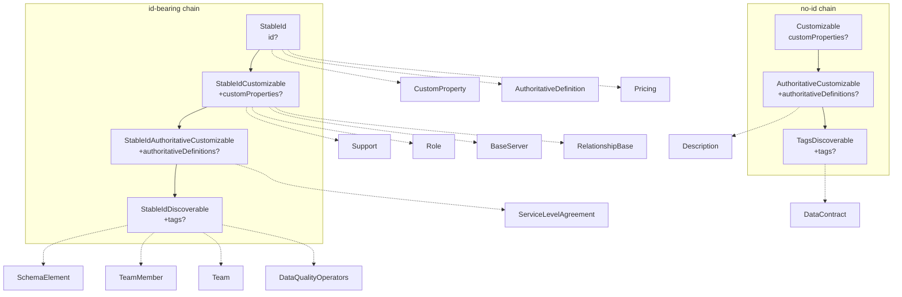

# `common` module

Definitions reused by every other module. The `common` module is where the library's **code-reuse decisions** are made:
the stable `id`, `customProperties`, `authoritativeDefinitions`, and `tags` are defined once here and **inherited** by
the schemas in `catalog`, `contract`, `iam`, `quality`, `server`, and the root `odcs.k`.

---

## Schema Mapping

| Module Path                                              | KCL schema                  | ODCS JSON Schema entity                                                                    |
|----------------------------------------------------------|-----------------------------|--------------------------------------------------------------------------------------------|
| [`common/id.k`](../../common/id.k)                       | `StableId`                  | `$defs/StableId`                                                                           |
| [`common/property.k`](../../common/property.k)           | `CustomProperty`            | `$defs/CustomProperty`                                                                     |
| [`common/authoritative.k`](../../common/authoritative.k) | `AuthoritativeDefinition`   | `$defs/AuthoritativeDefinitions` (item object)                                             |
| [`common/custom.k`](../../common/custom.k)               | `Customizable`              | `$defs/CustomProperties` (array wrapper)                                                   |
| [`common/custom.k`](../../common/custom.k)               | `AuthoritativeCustomizable` | `$defs/CustomProperties`, `$defs/AuthoritativeDefinitions`                                 |
| [`common/custom.k`](../../common/custom.k)               | `StableIdCustomizable`      | `$defs/StableId`, `$defs/CustomProperties`                                                 |
| [`common/custom.k`](../../common/custom.k)               | `StableIdAuthoritativeCustomizable` | `$defs/StableId`, `$defs/CustomProperties`, `$defs/AuthoritativeDefinitions`       |
| [`common/discovery.k`](../../common/discovery.k)         | `StableIdDiscoverable`      | `$defs/StableId`, `$defs/CustomProperties`, `$defs/Tags`, `$defs/AuthoritativeDefinitions` |
| [`common/discovery.k`](../../common/discovery.k)         | `TagsDiscoverable`          | `$defs/CustomProperties`, `$defs/AuthoritativeDefinitions`, `$defs/Tags`                   |

---

## Architecture Decisions

### Several `common` schemas map to *multiple* JSON `$defs`

- Schemas are **composition bases**: rather than repeat `customProperties` / `authoritativeDefinitions` / `tags` on
  every consumer (as the JSON Schema does via repeated `$ref`s)
- The library folds those shared arrays into a few base classes that other schemas extend.

### Two parallel inheritance chains, forked over the stable `id`

- KCL allows a single base class per schema, so the shared concerns are arranged as two symmetric chains, each node
  adding one attribute:
    - **id-bearing:** `StableId (id?)` → `StableIdCustomizable (+customProperties?)` →
      `StableIdAuthoritativeCustomizable (+authoritativeDefinitions?)` → `StableIdDiscoverable (+tags?)`.
    - **no-id:** `Customizable (customProperties?)` → `AuthoritativeCustomizable (+authoritativeDefinitions?)` →
      `TagsDiscoverable (+tags?)`.
- `StableIdAuthoritativeCustomizable` arrived with ODCS v3.2.0, whose SLA entries (RFC 0046) need an id,
  `customProperties` and `authoritativeDefinitions` but no `tags`. `StableIdDiscoverable` now inherits
  `authoritativeDefinitions` instead of declaring it, so every schema below it keeps the same attributes.

### Deliberate, minimal duplication

- `customProperties`, `authoritativeDefinitions` and `tags` are each declared once per chain because the two chains
  cannot share a node without multiple inheritance.
- This is one-attribute duplication and the accepted cost of serving both the "has stable id" and "free/no id" families
  through inheritance.

### Leaf objects vs. array wrappers are separated.

- `CustomProperty` / `AuthoritativeDefinition` are the item objects.
- The `customProperties` / `authoritativeDefinitions` *arrays* live on the base classes above.

### `CustomProperty.vendor` is free text

- RFC 0035 adds `vendor`, which SHOULD match `^[a-z0-9][a-z0-9-]*$` but MUST be preserved when unknown. The library
  types it as `str` and adds no pattern check, so `Unknown-Vendor` validates while a non-string is rejected.

### Guarded `StableId.id` regex

- `StableId.id` is validated only when present (`... if id`), against the RFC-0026a **denylist** copied verbatim from
  the JSON `StableId` pattern: `^[^\s.#/\\@!%&^]+$`. An id cannot contain `.`, `#`, `/`, `\`, `@`, `!`, `%`, `&`, `^`
  or whitespace; everything else is allowed, so namespaced ids (`fdir:ISU:TAD`, `urn:uuid:…`) are valid.
- ODCS v3.1.0 used the allowlist `^[A-Za-z0-9_-]+$`, which rejected those ids.
- Any element carrying an optional `id` can still be constructed without one, while a malformed `id` is rejected.
- Every `StableId` subschema inherits the pattern, including relationships (RFC 0047, see `catalog.md`).

---

## Open Questions

### Attribute Duplication

- The two-chain design trades a small duplication (`customProperties`, `tags` declared twice) for full inheritance-based
  reuse.
- A future KCL feature (or a different modeling of `id`) might collapse the two chains into one.
- Until then the duplication is intentional.
